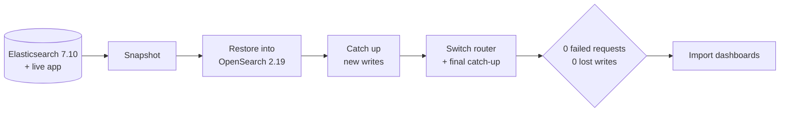

# Elasticsearch to OpenSearch migration

An Elasticsearch 7.10 cluster moved to OpenSearch 2 **while an application keeps writing and searching**, in dev, staging and prod.
Each run proves **no request failed** and **no acknowledged write was lost**, then moves the Kibana dashboards too.

[Live pipeline →](https://danielkojomegbenu.com/projects/elasticsearch-to-opensearch)

## The pipeline



The same migration runs as three parallel jobs: **dev** (2,000 documents), **staging** (20,000) and **prod** (100,000).

| Step | What happens | Fails the run when |
|---|---|---|
| 1. Start | Elasticsearch 7.10 gets a week of history, and the app starts writing a document every 50 ms and searching every 250 ms, **only ever through an nginx router** | |
| 2. Snapshot | A snapshot of the index into a shared repository. The app keeps writing | |
| 3. Restore | OpenSearch restores the snapshot | |
| 4. Catch up | OpenSearch pulls everything written since the snapshot from Elasticsearch (reindex from remote) | |
| 5. Switch | The router is pointed at OpenSearch with a graceful nginx reload, then a final catch-up copies the last few seconds | |
| 6. Verify | The app stops and reports. Every acknowledged write must be in OpenSearch, and no request may have failed | Any write is missing or any request failed |
| 7. Dashboards | The Kibana 7.10 saved objects are imported into OpenSearch Dashboards and checked against real data | The import fails or finds no data |

## Why zero downtime works

- **The app never knows.** It only talks to the router. Moving it is one config line and a graceful reload: new workers start, old ones finish their requests.
- **Nothing is lost between snapshot and switch.** Two catch-ups copy every document written since the snapshot, with a 5-second overlap. They reuse document IDs, so copying a document twice is harmless.
- **Proof, not hope.** The verify step compares the app's own count of acknowledged writes with what is actually in OpenSearch.

## See a shortcut lose data

Open the pull request **demo/skip-catch-up**. It switches the router straight after the restore, with no catch-up.
The app never sees an error, but the **Verify** step finds that the writes made during the migration are missing from OpenSearch, and fails.

## Run it on your machine

```bash
docker compose up -d --wait elasticsearch opensearch router && docker compose up -d dashboards
python3 scripts/seed.py 2000
python3 app/app.py http://localhost:8080 &
for step in snapshot restore catchup switch verify; do bash scripts/migrate.sh $step; done
bash scripts/import_dashboards.sh
```

Then open OpenSearch Dashboards at http://localhost:5601.

## What's in the repo

| Path | What it is |
|---|---|
| `docker-compose.yml` | Elasticsearch 7.10, OpenSearch 2.19, OpenSearch Dashboards and the router |
| `router/default.conf` | The router the app talks to |
| `app/app.py` | The application that keeps writing and searching |
| `scripts/seed.py`, `scripts/migrate.sh`, `scripts/import_dashboards.sh` | Seeding, the migration steps and the dashboards move |
| `dashboards/kibana-7.10-export.ndjson` | The Kibana saved objects being migrated |
| `.github/workflows/migrate.yml` | The pipeline, with one job per environment |

## Cost

Free. Everything runs on GitHub's runners, and GitHub Actions is free for public repos.
